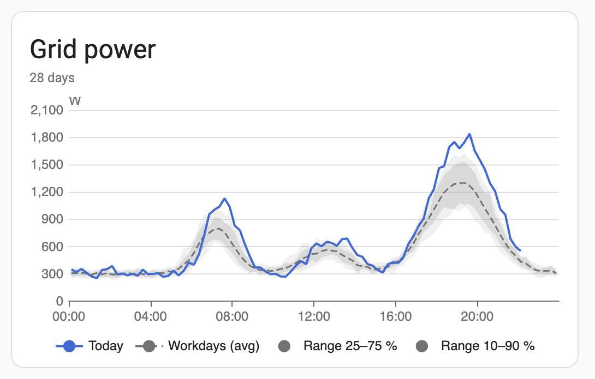
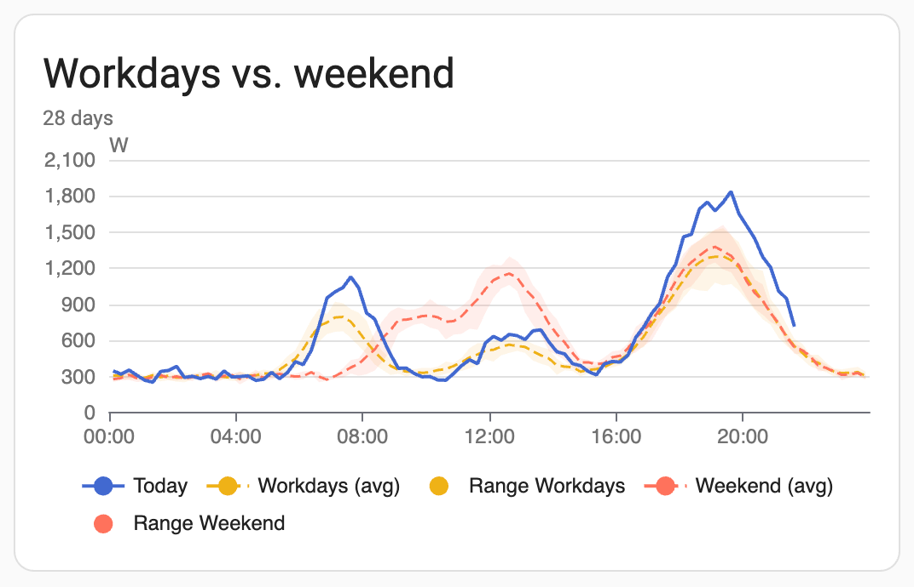
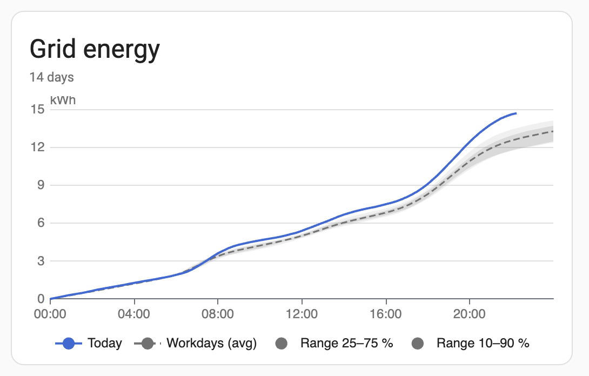
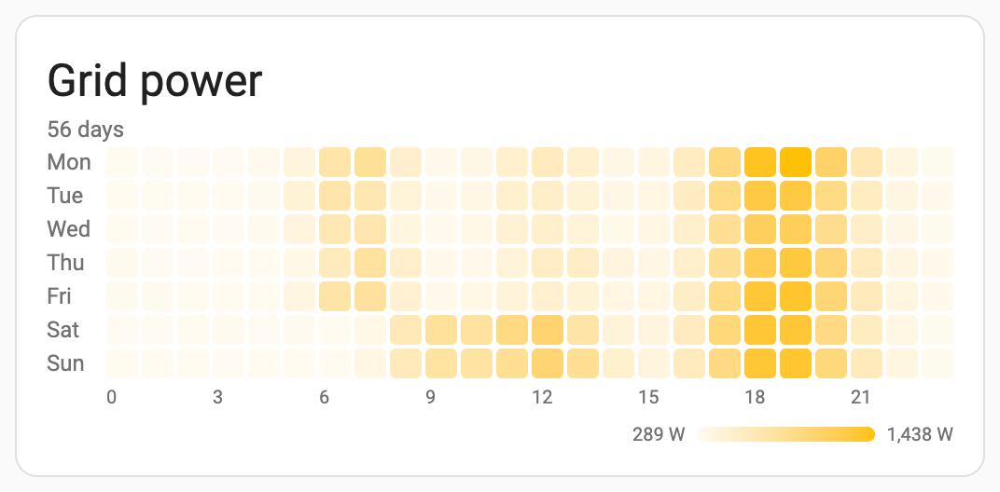
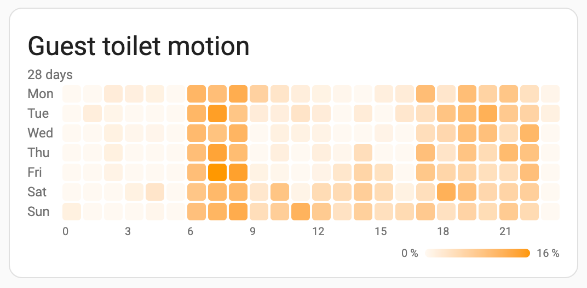
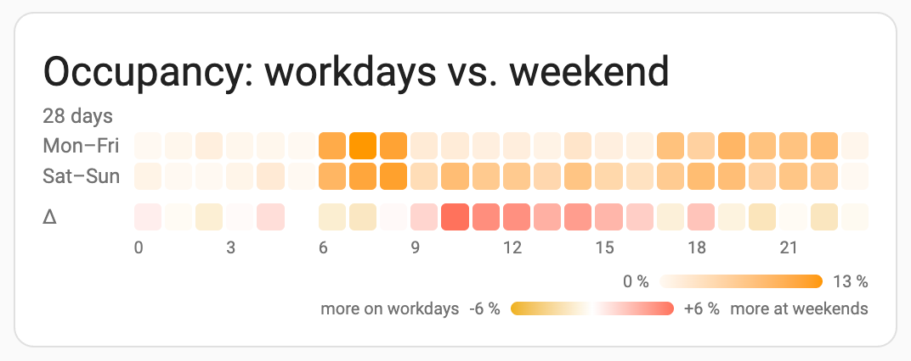
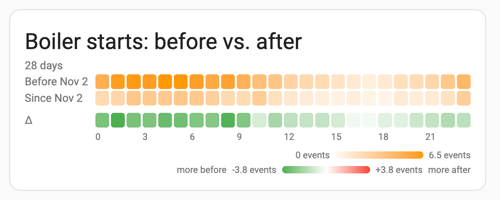

# Pattern Card

A Home Assistant Lovelace card that shows the **daily and weekly patterns** of a single entity: is today a normal day, and when is a room usually occupied?



- **Graph**: today's curve against a reference period, by time of day. The reference is shown as a mean line with two nested bands (25–75 % and 10–90 % of the reference days).
- **Heatmap**: weekday × time of day. Each cell shows the share of time active, the number of events, the mean or the consumption.
- **Workdays vs. weekend**: compare both kinds of days in one graph, or in a heatmap with a difference row.

It is meant to look and behave like a native card. The graph uses Home Assistant's own chart component, and theme colors as well as number and time formats follow your profile. The card picks its data source by itself: long-term statistics where they exist, history otherwise. It comes with a visual editor and is translated into English and German.

> The screenshots show simulated data, rendered in the development preview. In Home Assistant the legend uses the native chips of the chart component.

## Installation

### HACS
1. HACS → ⋮ → **Custom repositories** → add `https://github.com/luc-ass/pattern-card`, type **Dashboard**
2. Search for *Pattern Card*, install it and reload the browser

HACS adds the dashboard resource for you.

### Manual
1. Take `pattern-card.js` from the source archive of the [latest release](https://github.com/luc-ass/pattern-card/releases/latest) and copy it to `<config>/www/`
2. Settings → Dashboards → ⋮ → **Resources** → add `/local/pattern-card.js` as *JavaScript module*
3. Reload the browser

## Examples

### Is today a normal day?

```yaml
type: custom:pattern-card
entity: sensor.grid_power
```

Today (solid line) against the reference days (dashed mean). By default the reference consists of the days of the same kind as today, so a Thursday is compared with Mon–Fri, a Saturday with Sat–Sun. The inner band holds the middle half of those days, the outer band 80 % of them.


### Workdays vs. weekend

```yaml
type: custom:pattern-card
entity: sensor.grid_power
compare: weekday_weekend
name: Workdays vs. weekend
```

Two references in one graph, each with its own band, colored with Home Assistant's second and third graph colors. Every line and band can be toggled in the legend.



### Consumption since midnight

```yaml
type: custom:pattern-card
entity: sensor.grid_energy
cumulative: true
days: 14
```

For counters (`state_class: total` or `total_increasing`): how much has been used so far today, compared with what is usual up to this time.



### When is power used?

```yaml
type: custom:pattern-card
entity: sensor.grid_power
mode: heatmap
days: 56
color: amber
```

Mean per weekday and hour over eight weeks.



### Room occupancy

```yaml
type: custom:pattern-card
entity: binary_sensor.guest_toilet_motion
mode: heatmap
```

For on/off entities the heatmap shows the share of each hour the entity was active. With `statistic: events` it counts how often it switched on instead.



### Occupancy: workdays vs. weekend

```yaml
type: custom:pattern-card
entity: binary_sensor.guest_toilet_motion
mode: heatmap
compare: weekday_weekend
```

Two rows instead of seven, plus a difference row (Δ = weekend − workdays). The difference row is colored with the workday color where workdays are higher and the weekend color where weekends are higher.



### Before vs. after a change

```yaml
type: custom:pattern-card
entity: binary_sensor.boiler_pump_running
mode: heatmap
statistic: events
compare: before_after
since: "2026-11-12"
difference_colors: [green, red]   # fewer starts = good
```

Did a new pump setting reduce how often the boiler starts? The heatmap shows the days before and from the given date on, plus a difference row (after − before). In graph mode both periods appear as two references. `difference_colors` sets the colors for "less" and "more" in the difference row, here green for fewer starts. For a temperature you might use `[blue, red]`; `compare_colors` sets the colors of the two periods themselves.



## Options

All options can also be set in the visual editor.

| Option | Default | Description |
| --- | --- | --- |
| `entity` | – | Entity to analyse (required) |
| `mode` | `graph` | `graph` or `heatmap` |
| `name` | friendly name | Card title; `false` or a single space hides it (in the visual editor, enter a space) |
| `days` | `28` | Completed days before today used for the reference and the heatmap |
| `weekdays` | all | Only use these weekdays (`mon` … `sun`) |
| `statistic` | by type | `active` or `events` for states, `mean` for measurements, `sum` for counters |
| `resolution` | `auto` | `auto`, `5min`, `15min`, `30min`, `hour`. Auto: graph 15 min where the data allows it, heatmap 1 h |
| `compare` | `none` | `weekday_weekend`: the graph shows workdays and weekend as two references; the heatmap shows Mon–Fri and Sat–Sun plus a difference row. `before_after`: days before vs. from `since` on, e.g. to check the effect of a change |
| `compare_colors` | graph colors 2 and 3 | With `compare`: colors of the two groups (lines, bands, tooltip), e.g. `[blue, red]` |
| `difference_colors` | `compare_colors` | Heatmap with `compare`: colors of the difference row for less and more, e.g. `[green, red]` when less is better |
| `since` | – | With `compare: before_after`: date of the change (`YYYY-MM-DD`) |
| `reference` | `auto` | Graph without `compare`: `auto` uses the days of the same kind as today, `all` uses every day. Ignored when `weekdays` is set |
| `difference` | `true` | Heatmap with `compare`: show the difference row |
| `band` | `both` | Graph: `both` (10–90 % and 25–75 %), `iqr` (25–75 %), `wide` (10–90 %), `minmax`, `none` |
| `cumulative` | `false` | Graph, counters only: consumption since midnight |
| `hide_subtitle` | `false` | Hide the line below the title (period, days with data, resolution hints) |
| `hide_legend` | `false` | Hide the legend (graph: series, heatmap: color scale), as in the native statistics graph card |
| `color` | state color | Color of today's line or of the heatmap: hex, CSS or a theme color name such as `amber` |
| `colors` | – | Heatmap: list of two or more colors from low to high, e.g. `["#e3f2fd", "#0d47a1"]` |
| `min`, `max` | from data | Heatmap: scale limits |

## How it works

### Data sources

| Entity | Source | Values |
| --- | --- | --- |
| On/off-like states (`binary_sensor`, `light`, `switch`, `person`, …) | History | share active, events |
| Events, buttons, scenes | History | events |
| Sensors with `state_class: measurement` | Long-term statistics | mean |
| Counters (`total`, `total_increasing`) | Long-term statistics | consumption |
| Numeric sensors without statistics | History | time-weighted mean |

- **History only reaches back as far as the recorder keeps it** (`recorder: purge_keep_days`, 10 days by default). For a longer reference, raise it.
- **Resolution**: the 5-minute statistics are kept for the same time as the history. If they do not cover the whole period, the graph falls back to hourly values and says so below the title.
- **Today is never part of the reference.** The heatmap only uses completed time slots.
- **Time slots follow the wall clock** in the time zone of your profile; days with a daylight saving change are handled.
- **Attributes are not supported.** To analyse one, create a template sensor with a `state_class`, so it also gets long-term statistics.

### Bands

The bands use percentiles rather than standard deviations. Power or occupancy data is rarely normally distributed, and ±2σ would run below zero or above 100 %.

| Days with data | Bands shown |
| --- | --- |
| 10 or more | 10–90 % and 25–75 % |
| 4 to 9 | 25–75 % only; the tooltip says from when 10–90 % appears |
| fewer than 4 | min–max |

With `compare`, `both` shows only the 25–75 % band per reference, so the graph does not end up with four overlapping areas.

## Development

- `npm test` runs the tests with jsdom.
- `npm run preview` builds `preview.html` with simulated data. The graph is drawn there by a small ECharts stand-in for Home Assistant's chart component. Open it with `?lang=en` for English.

> `ha-chart-base` is an internal component of the Home Assistant frontend. The card is tested against frontend `20261028.5` (HA 2026.11). After Home Assistant updates, check that the graph still renders.

## License

MIT
